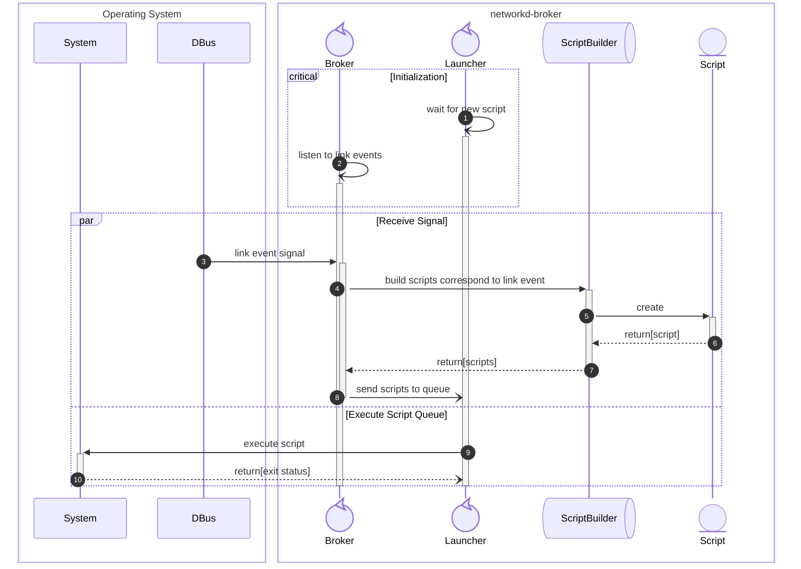

# Networkd-broker

[](https://github.com/bpetlert/networkd-broker/releases/latest)
[](https://aur.archlinux.org/packages/networkd-broker)
[](./COPYING)

The **networkd-broker** is an event broker daemon for systemd-networkd.
It will execute scripts in the `/etc/networkd/broker.d/<STATE>.d` directory in alphabetical order in response to network events.

This work is based on [networkd-dispatcher](https://gitlab.com/craftyguy/networkd-dispatcher), written in Rust, for the purpose of reducing runtime dependencies.
This also helps reduce memory footprint (~30MB &longrightarrow;
~8MB) and improve startup time (~30secs ⟶ ~1sec for spinning hard disk drive).

## Installation

### Arch Linux

It is available on AUR as [networkd-broker](https://aur.archlinux.org/packages/networkd-broker).
To build and install the arch package from GIT source:

```bash
git clone https://github.com/bpetlert/networkd-broker.git
cd networkd-broker
makepkg -p PKGBUILD.local
pacman -U networkd-broker-xxxx-1-x86_64.pkg.tar
```

Then enable/start `networkd-broker.service`.

```bash
systemctl enable --now networkd-broker.service
```

## Configuration

To change the options of networkd-broker service e.g. enable debug, run `systemctl edit networkd-broker.service`

```ini
# /etc/systemd/system/networkd-broker.service.d/override.conf

[Service]
Environment='RUST_LOG=networkd_broker=debug'
```

Or enable `--startup-triggers`.
Start this service after `systemd-networkd.service` to ensure network devices are already configured or renamed.

```ini
# /etc/systemd/system/networkd-broker.service.d/override.conf

[Unit]
Wants=systemd-networkd.service
After=systemd-networkd.service

[Service]
ExecStart=
ExecStart=/usr/bin/networkd-broker --startup-triggers
```

## Usage

The scripts for any network event need to be put (or symlink) in its corresponding directory as shown below.
Each script must be a regular executable file owned by root.
The default execution timeout of each script is 20 seconds.
It can be overridden by `--timeout` option in service configuration.
Any of the scripts with filename (exclude extension) ending with '-nowait' are run immediately, without waiting for the termination of previous scripts.
e.g. `script-nowait`, `script-nowait.sh`

```bash
# Directories of Commonly Used Network Events

/etc/networkd
└── broker.d
    ├── carrier.d
    ├── degraded.d
    ├── dormant.d
    ├── no-carrier.d
    ├── off.d
    └── routable.d
```

The scripts are run in alphabetical order, one at a time, with two arguments and a set of environment variables passed.
Each script runs asynchronously from `networkd-broker` process.
The initial working directory of each script is `/run/networkd-broker`.

_Table 1. Script's Arguments_

| Argument | Description                                                                                                                                            |
| -------- | ------------------------------------------------------------------------------------------------------------------------------------------------------ |
| `STATE`  | Current link status is one of the following: `carrier`, `degraded`, `dormant`, `no-carrier`, `off`, `routable`; see `man networkctl` for more details. |
| `IFACE`  | Link name that operation just happened on                                                                                                              |

The following environment variables are passed to each script:

_Table 2. Script's Environment Variables_

| Environment Variable | Description                                                      |
| -------------------- | ---------------------------------------------------------------- |
| `NWD_DEVICE_IFACE`   | Link name that operation just happened on, same value as `IFACE` |
| `NWD_BROKER_ACTION`  | Current link status, same value as `STATE`                       |
| `NWD_JSON`           | All the link details are encoded in JSON format.                 |

> [!TIP]
> Add Uncommonly Used Network Events
>
> There are link's `STATE` which are not list in Table 1, "Script’s Arguments".
> To find out which link state can be added, use the following command:
>
> ```bash
> journalctl -u networkd-broker.service | grep "Respond to" | grep -v -E "(carrier)|(degraded)|(dormant)|(no-carrier)|(off)|(routable)"
>
> ...  INFO networkd_broker::broker: Respond to 'enslaved' event of 'vethbece646'
> ```
>
> The result shows that event `enslaved` can be used for device `vethbece646`.
> To use this event, create directory `/etc/networkd/broker.d/enslaved.d` and put scripts in it.

### Example Usage

The script below activates/deactivates [Chrony](https://wiki.archlinux.org/index.php/Chrony) corresponding to link state of `wlp3s0` link.
This is useful if your computer is not connected to the internet on startup and use `offline` option for NTP sources.
The script must be put (or symlink) in `/etc/networkd/broker.d/routable.d`, and `/etc/networkd/broker.d/no-carrier.d`.

```bash
#!/usr/bin/env bash
# /usr/local/bin/chrony-switch

STATE=$1
IFACE=$2
DEV=wlp3s0

if [[ "$IFACE" != "$DEV" ]]; then
    exit 2
fi

if [[ "$STATE" = "routable" ]]; then
    chronyc online > /dev/null
    chronyc burst 4/4 > /dev/null
    sleep 10
    chronyc makestep > /dev/null
    echo "Activate chrony"
    exit 0
elif [[ "$STATE" = "no-carrier" ]]; then
    chronyc offline > /dev/null
    echo "Deactivate chrony"
    exit 0
fi

exit 0
```

Create symlink in `no-carrier.d` and `routable.d`.

```bash
/etc/networkd
└── broker.d
    ├── carrier.d
    ├── degraded.d
    ├── dormant.d
    ├── no-carrier.d
    │   └── 10-chrony-switch -> /usr/local/bin/chrony-switch
    ├── off.d
    └── routable.d
        └── 10-chrony-switch-nowait -> /usr/local/bin/chrony-switch
```

And optionally make `networkd-broker.service` as dependency of `chronyd.service` to ensure chrony service started before call `chrony-switch`.

```ini
# /etc/systemd/system/networkd-broker.service.d/override.conf

[Unit]
Wants=systemd-networkd.service chronyd.service
After=systemd-networkd.service chronyd.service

[Service]
ExecStart=
ExecStart=/usr/bin/networkd-broker --startup-triggers
```

## Design



## License

[GNU General Public License v3.0 or later](./COPYING)

[networkd-broker](https://github.com/bpetlert/networkd-broker):\
Copyright (C) 2019 [Bhanupong Petchlert](mailto:bpetlert@gmail.com)

[networkd-dispatcher](https://gitlab.com/craftyguy/networkd-dispatcher):\
Copyright (C) 2018 [Clayton Craft](mailto:clayton@craftyguy.net)

[networkd-notify](https://github.com/wavexx/networkd-notify):\
Copyright (C) 2016 [Yuri D'Elia](mailto:wavexx@thregr.org)
